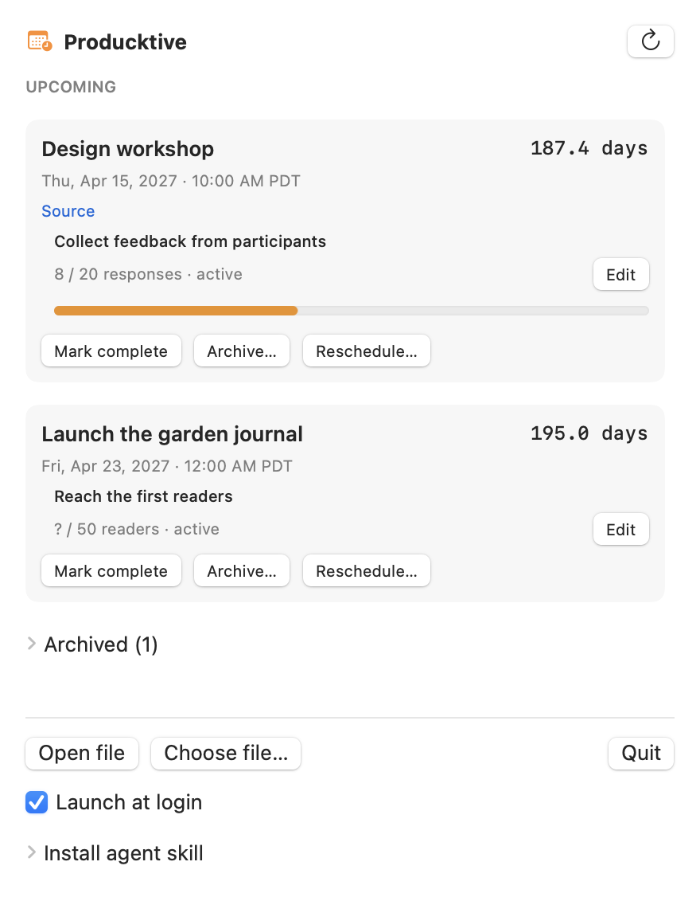

# Producktive

A native Mac menu bar app that keeps deadlines and their goals visible. Local
Markdown data, decimal-day countdowns, and overdue events that remain visible
until you resolve them. macOS 13 or later, Apple silicon and Intel.

## Install

Download the universal app from [Releases](https://github.com/UXDuck/producktive/releases),
unzip, and move **Producktive.app** into Applications. Launch it and choose your
Markdown deadline file. The app appears in the menu bar without a Dock icon.

First launch creates an empty `~/.producktive/deadlines.md` if no config or default
file exists. Add your deadlines with an agent, a text editor, or the bundled CLI.
[examples/deadlines.md](examples/deadlines.md) contains fictional data only.

To build and install from source, use Xcode 15+ or Swift 5.9+:

```sh
swift test
scripts/build-app.sh
scripts/install.sh codex claude cursor
open "$HOME/Applications/Producktive.app"
```

Open `Package.swift` in Xcode to browse the reusable core, application, CLI, and
tests. `scripts/build-app.sh` assembles a universal native `.app`; no generated
Xcode project or third-party project generator is required. Yams 6.2.2 is the
sole package dependency, pinned by `Package.resolved`.

## Deadlines



The menu bar selects the earliest unresolved active event. Overdue events take
precedence and stay active until **Mark complete** or **Archive**. Ties use stable
IDs. Long titles are truncated in the menu bar and displayed fully in the panel.
Every active row shows its own countdown, exact date/time, and goals.

Days are remaining seconds divided by 86,400, displayed with one decimal at every
distance. The displayed magnitude has an explicit “overdue” suffix after arrival.
A rounded `0.0 days` can still be upcoming. DST does not redefine a day. Dates
default to Pacific midnight; travel changes the displayed local time, while the
original event time remains visible. Completing an event preserves each goal's
progress and status without claiming the goal was achieved.

See [the file schema](docs/schema.md) for fields and safe-write behavior.

## Choose a file

`~/.producktive/config.yaml` can contain:

```yaml
deadlines_file: "~/Documents/My deadlines.md"
```

The selected file is the sole source. Relative paths are rejected. **Choose
file…** validates a file before updating this setting. Config and deadline files
are watched, including atomic replacement saves made by editors such as Obsidian.

## Agent skill and CLI

Use **Install agent skill** in the panel to select Codex, Claude Code, or Cursor.
The installer reports each destination and refuses to overwrite unrelated skills.
It installs a safe-edit CLI at `~/.producktive/bin/producktive-cli`.

| Agent | User skill directory | Official documentation |
|---|---|---|
| Codex | `~/.agents/skills/producktive` | [Codex skills](https://learn.chatgpt.com/docs/build-skills#where-codex-loads-local-skills) |
| Claude Code | `~/.claude/skills/producktive` | [Claude skills](https://code.claude.com/docs/en/skills) |
| Cursor | `~/.cursor/skills/producktive` | [Cursor skills](https://cursor.com/docs/skills) |

Directories verified October 9, 2026. Codex and Cursor both discover the shared
`.agents` directory; selecting Codex can also make the skill visible to Cursor.

```sh
~/.producktive/bin/producktive-cli validate
~/.producktive/bin/producktive-cli list
~/.producktive/bin/producktive-cli reschedule review-id '2027-04-15T10:00:00'
~/.producktive/bin/producktive-cli goal review-id feedback-id 12 active
~/.producktive/bin/producktive-cli complete review-id 'Review held.'
```

`add-event` accepts a JSON event; `add-goal` accepts an event ID and JSON goal.
`--file /absolute/path/deadlines.md` overrides config for any data command.
See [the bundled skill](skills/producktive/SKILL.md) for examples.

## Troubleshooting

Malformed edits keep the last valid snapshot with a persistent red **Stale data**
message and a warning in the menu bar. Edit the file to correct the error or select
a valid file. Mutating controls are disabled while stale. Empty files/lists and
missing files are handled explicitly. The refresh button retries loading.

Ambiguous or nonexistent local DST times are rejected; supply a verified time or
an explicit UTC offset. Duplicate IDs, unknown zones, and invalid intervals are
also rejected. Archived records need both status and reason. YAML aliases and
merge keys are unsupported. Flow-style records can be read, but edit them into
block style before using app controls.

If an edit reports a conflict, reload and review the other editor's changes before
retrying. Pre-edit `deadlines.md.backup-UUID` files are recoverable UTF-8 originals;
keep or remove them manually. The app never silently deletes backups.

**Launch at login** uses Apple's ServiceManagement registration. macOS may require
approval in System Settings → General → Login Items. Install the app in Applications
before enabling it. No network access, analytics, AI service, or per-row timer runs
in the application.

## Release and validation

[Validation notes](docs/validation.md) record actual tests and performance results.
Builds default to ad hoc signing; CI artifacts are not notarized. To produce a
Developer ID release, set `SIGNING_IDENTITY` and a `NOTARY_PROFILE` stored with
`xcrun notarytool store-credentials`, then run `scripts/package-release.sh`.
The release notes state the actual signing and notarization status.

MIT licensed. Public examples, tests, screenshots, and CI contain fictional data.
